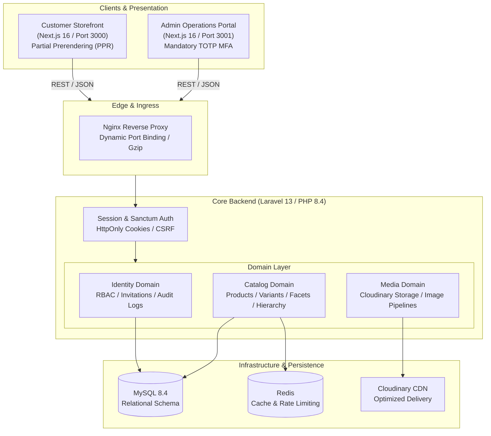

# GlowCare — Beauty Commerce Platform

An enterprise-grade, API-first beauty and skincare commerce platform engineered for high-performance retail in South Asia. Built with a **Laravel 13** domain-driven core API, an independently deployable **Next.js 16 (App Router)** customer storefront, and a dedicated **Next.js 16** administrative portal.

---

## 1. System Architecture

GlowCare follows a headless, decoupled monorepo architecture where the API, customer storefront, and back-office administrative portal maintain distinct deployment lifecycles and security boundaries.



---

## 2. Monorepo Structure

```text
beauty_ecomerce_platform/
├── backend/          # Laravel 13 Core REST API (PHP 8.4, MySQL, Redis, Cloudinary)
│   ├── app/Domain/   # DDD Domain modules (Catalog, Identity, Media)
│   ├── docker/       # Production Nginx, PHP-FPM, Supervisor configs
│   ├── Dockerfile    # Railway/Production single-container image
│   └── railway.json  # Railway build & deploy configuration
│
├── frontend/         # Customer Storefront (Next.js 16, React 19, Tailwind CSS v4)
│   ├── src/app/      # App Router pages (Home, Products, Categories, Brands)
│   ├── src/features/ # Domain features (Catalog, Cart, Auth, Search)
│   └── src/components/ ui / primitives (Multi-select, Dropdowns, Cards)
│
├── admin/            # Staff Operations Portal (Next.js 16, Tailwind CSS v4)
│   ├── src/app/      # Admin routes (/dashboard, /login, /mfa)
│   └── src/features/ # Staff management, catalog management, audit logs
│
├── docs/             # Technical specifications, ADRs & API contracts
└── compose.yaml      # Unified local development environment
```

---

## 3. Key Technical Highlights

- **Domain-Driven Backend:** Clean separation between `Catalog`, `Identity`, and `Media` domains with strict invariant enforcement and zero circular dependencies.
- **Enterprise Security:** Mandatory TOTP Multi-Factor Authentication (MFA) for staff, expiring cryptographic invitations, stateful HttpOnly session cookies, and detailed RFC 9457 Problem Details error responses.
- **Localized E-Commerce:** Built-in support for Bangladeshi Taka (`৳`), localized SKU/variant structures, and shade/attribute filtering.
- **Next.js 16 Streaming & PPR:** Customer storefront utilizes Partial Prerendering with streaming `<Suspense>` boundaries to ensure zero blocking during page hydration.
- **Advanced Multi-Select Filtering:** Accessible, reusable multi-select dropdowns for subcategories and brands with instant keyword search and zero border-overlap issues.
- **Turnkey Production Deployment:** Single-container Docker image with Nginx, PHP-FPM, and Supervisor optimized for **Railway**, alongside automated migration hooks and `/up` health checks.

---

## 4. Prerequisites

| Tool | Version Requirement | Purpose |
| :--- | :--- | :--- |
| **PHP** | `^8.3` (PHP 8.4 recommended) | Backend CLI and testing |
| **Composer** | `^2.7` | PHP package management |
| **Node.js** | `>= 22.12.0` | Frontend and Admin runtimes |
| **npm** | `>= 10.0.0` | JavaScript package management |
| **MySQL** | `8.4` or `8.0` | Primary relational database |
| **Docker Desktop** | Latest (optional) | Containerized local workflow |

---

## 5. Local Development Quickstart

### Method A: Docker Compose (All-in-One)

1. **Clone the repository and copy environment configurations:**
   ```bash
   cp .env.example .env
   cp backend/.env.example backend/.env
   cp frontend/.env.example frontend/.env.local
   cp admin/.env.example admin/.env.local
   ```

2. **Boot the infrastructure containers:**
   ```bash
   docker compose up -d --build
   ```

3. **Initialize the backend database:**
   ```bash
   docker compose exec app php artisan key:generate
   docker compose exec app php artisan migrate
   docker compose exec app php artisan db:seed --class=RoleSeeder
   docker compose exec app php artisan identity:provision-super-admin
   ```

---

### Method B: Native Bare-Metal Setup

#### Step 1: Backend Setup
```bash
cd backend
cp .env.example .env
composer install

# Update DB_* variables in .env with your local MySQL credentials
php artisan key:generate
php artisan migrate
php artisan db:seed
php artisan serve --port=8000
```
> The API will be available at `http://localhost:8000`.

#### Step 2: Customer Storefront Setup
```bash
cd frontend
cp .env.example .env.local
npm install
npm run dev
```
> The storefront will run at `http://localhost:3000`.

#### Step 3: Admin Operations Portal Setup
```bash
cd admin
cp .env.example .env.local
npm install
npm run dev
```
> The admin portal will run at `http://localhost:3001`.

---

## 6. Monorepo Quality Matrix

Run quality gates across the applications before opening a pull request:

```bash
# Backend Quality Checks (Pint formatting, Larastan, PHPUnit)
cd backend && composer test

# Frontend Quality Checks (ESLint, TypeScript strict, Vitest, Webpack build)
cd frontend && npm run quality

# Admin Quality Checks (ESLint, TypeScript, Vitest, Webpack build)
cd admin && npm run quality
```

---

## 7. Production Deployment Overview

- **Backend:** Deployed to **Railway** using [`backend/Dockerfile`](backend/Dockerfile) and [`backend/railway.json`](backend/railway.json). Handles dynamic `$PORT`, executes automated migrations on launch, and reports health via `/up`.
- **Frontend & Admin:** Deployed independently to **Vercel** as static + Serverless/Edge Next.js applications targeting the Railway backend API URL.

For detailed configuration steps, consult the dedicated package documentation:
- [Backend Documentation](backend/README.md)
- [Customer Storefront Documentation](frontend/README.md)
- [Admin Portal Documentation](admin/README.md)
- [Architecture & API Decision Records](docs/)

---

## 8. License

This repository is proprietary software developed for the GlowCare Beauty Commerce Platform. All rights reserved.
