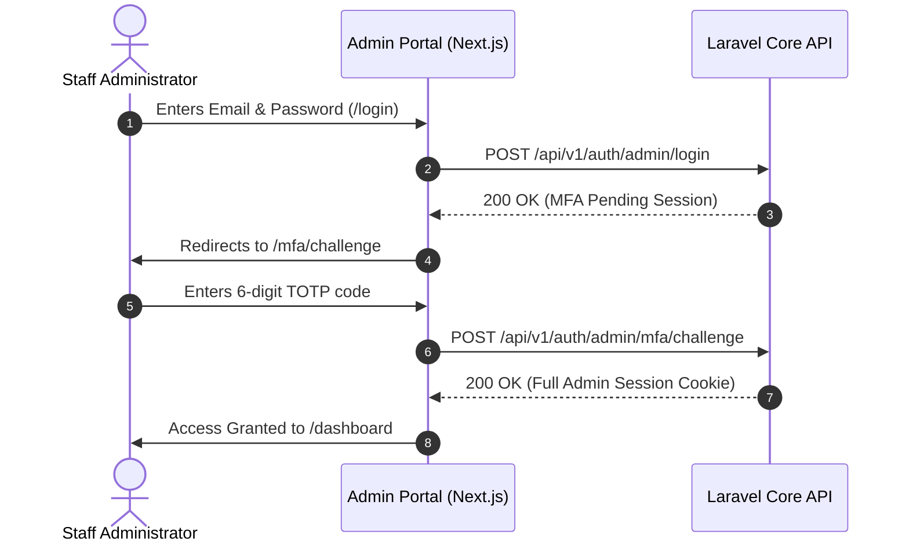

# GlowCare — Operations & Administration Portal

The independent back-office administrative application for the GlowCare platform. Engineered with **Next.js 16**, **React 19**, **Tailwind CSS v4**, and **strict TypeScript** to provide catalog management, inventory control, staff administration, and operational governance.

---

## 1. Security & Authentication Architecture

Security is central to the administrative portal's design:

- **Mandatory Multi-Factor Authentication (MFA):** Staff members cannot access the dashboard with passwords alone. Every session requires a verified 6-digit Time-based One-Time Password (TOTP) from an authenticator app (Google Authenticator, Authy, 1Password).
- **Staff Provisioning Boundary:** Public registration is disabled across the platform. The initial Super Administrator is provisioned directly via the backend CLI (`php artisan identity:provision-super-admin`). Subsequent staff are onboarded through time-limited cryptographic email invitations.
- **Authoritative Backend RBAC:** While the admin UI dynamically adapts based on staff permissions, the Laravel backend remains the sole authoritative source of truth for authorization. Spoofed client claims are rejected at the API middleware boundary.
- **Stateful HttpOnly Session Cookies:** All administrative authentication uses secure, encrypted cookies. Tokens are never stored in browser storage (`localStorage` or `sessionStorage`), protecting against XSS-based credential theft.



---

## 2. Core Functional Modules

- **Pink GlowCare Design System:** Built with a cohesive cosmetic aesthetic, semantic tokens, dark mode compatibility, and responsive side navigation.
- **Executive Dashboard (`/dashboard`):** Real-time analytics, revenue tracking, order volume statistics, customer growth indicators, and recent transaction feeds.
- **Catalog Management (`/dashboard/products`, `/categories`, `/brands`):**
  - Category hierarchy management with self-parent loop prevention guards.
  - Brand curation and asset association.
  - Product creation, variant matrix management (shades, sizes, formulas), and Cloudinary media gallery ordering.
- **Staff Governance (`/dashboard/staff`):**
  - Invitation management with expiration countdowns.
  - Role and permission matrix assignment (Catalog Manager, Order Dispatcher, Administrator, Super Admin).
- **Audit Logging (`/dashboard/audit-logs`):** Immutable log of all administrative mutations, recording actor IP, timestamp, entity diffs, and action types.

---

## 3. Technology Stack

- **Framework:** Next.js 16.4.5 (App Router, Turbopack)
- **UI Runtime:** React 19.3.0
- **Language:** TypeScript 5 (Strict Mode, exact optional properties)
- **Styling:** Tailwind CSS v4 (`@tailwindcss/postcss`)
- **Server State & Caching:** TanStack React Query v5 (`^5.106.1`)
- **Icons:** Lucide React (`^1.70.0`)
- **Testing:** Vitest 5 (`^5.1.0`) with React Testing Library

---

## 4. Local Setup & Configuration

### Requirements
- Node.js `^22.12.0`
- npm `^10.0.0`
- Laravel API running on `http://localhost:8000`

### Installation Steps

1. **Install dependencies:**
   ```bash
   cd admin
   npm install
   ```

2. **Configure environment variables:**
   ```bash
   cp .env.example .env.local
   ```
   Ensure `.env.local` points to your running backend:
   ```env
   NEXT_PUBLIC_API_URL=http://localhost:8000
   NEXT_PUBLIC_ADMIN_URL=http://localhost:3001
   ```

3. **Verify backend CORS settings:**
   Ensure `backend/.env` includes `http://localhost:3001` in both `CORS_ALLOWED_ORIGINS` and `SANCTUM_STATEFUL_DOMAINS`.

4. **Launch the development server:**
   ```bash
   npm run dev
   ```
   The portal runs on port `3001`: `http://localhost:3001`.

---

## 5. Development & Quality Commands

| Command | Purpose |
| :--- | :--- |
| `npm run dev` | Starts Turbopack development server on port 3001 |
| `npm run build` | Compiles production Webpack build |
| `npm run test` | Executes Vitest component & unit tests |
| `npm run lint` | Runs ESLint with zero-warning enforcement |
| `npm run typecheck` | Generates Next.js route types and executes strict TypeScript validation |
| `npm run format:check`| Verifies formatting compliance with Prettier |
| `npm run quality` | Executes complete quality gate: Lint, Typecheck, Test, and Build |

---

## 6. Production Deployment (Vercel)

The admin portal is engineered for independent deployment on **Vercel**:

1. **Connect Repository:** Import the repository in Vercel.
2. **Set Root Directory:** Choose `admin` as the **Root Directory**.
3. **Configure Environment Variables:**
   - `NEXT_PUBLIC_API_URL`: Your production backend URL (e.g. `https://api.yourdomain.com`).
   - `NEXT_PUBLIC_ADMIN_URL`: Your production admin portal URL (e.g. `https://admin.yourdomain.com`).
4. **Deploy:** Vercel builds the standalone Next.js admin app with edge caching and SSL. Ensure your backend's `CORS_ALLOWED_ORIGINS` and `SANCTUM_STATEFUL_DOMAINS` include this production admin domain.
